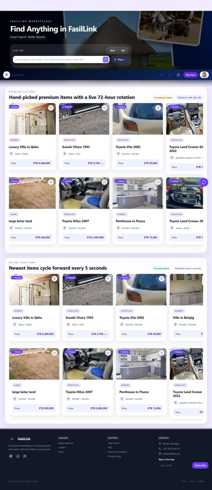
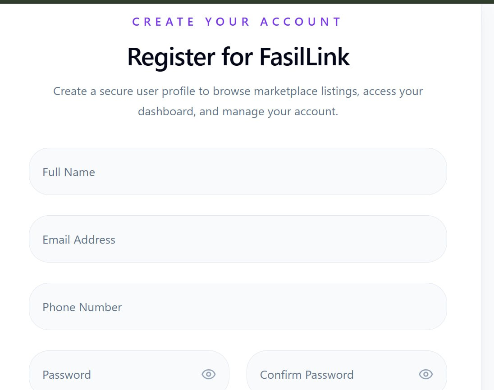
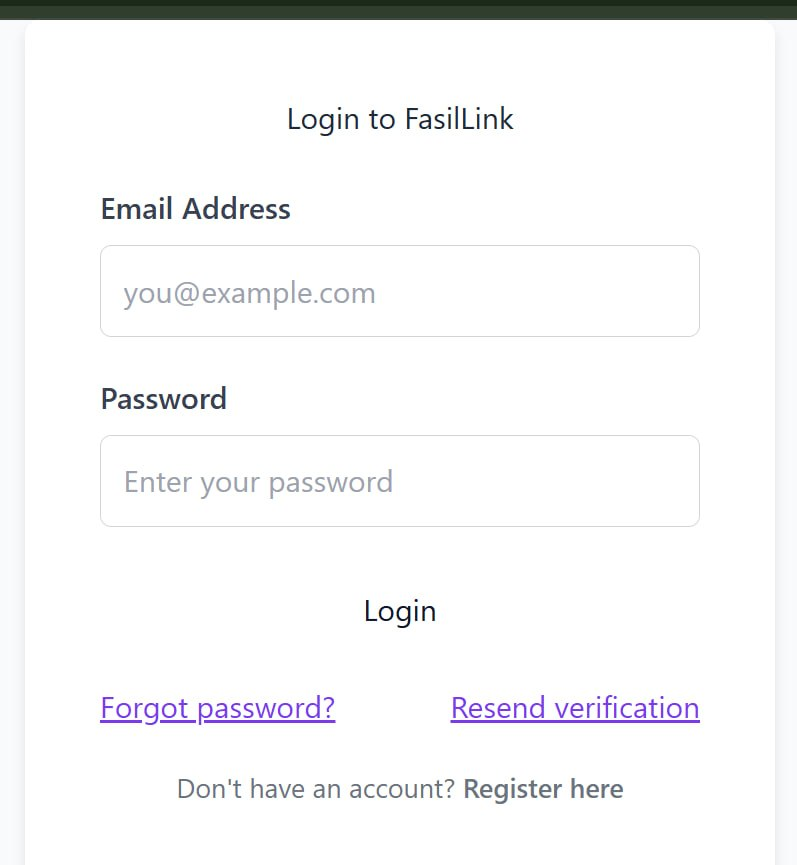
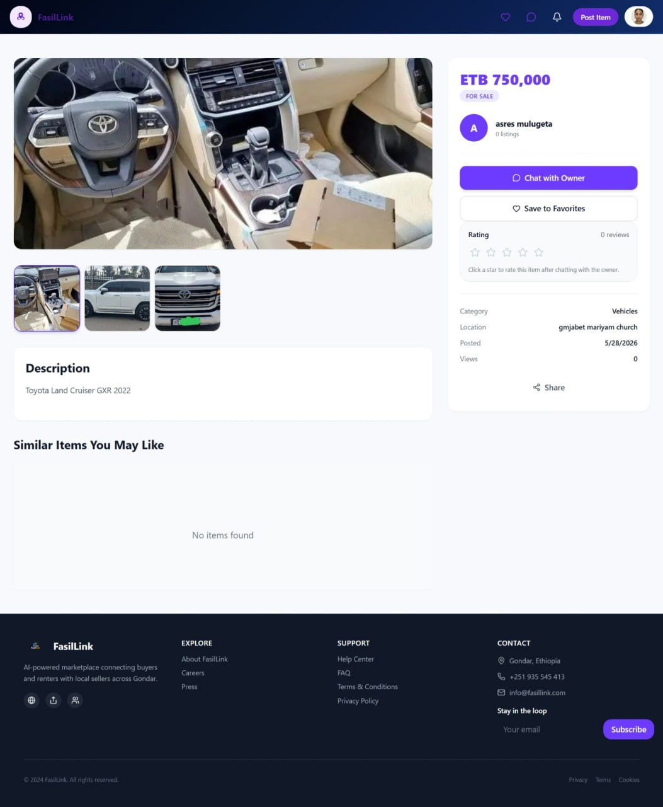
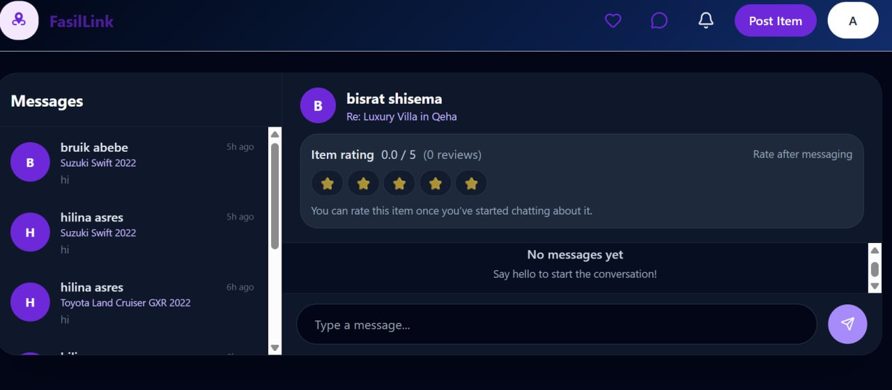
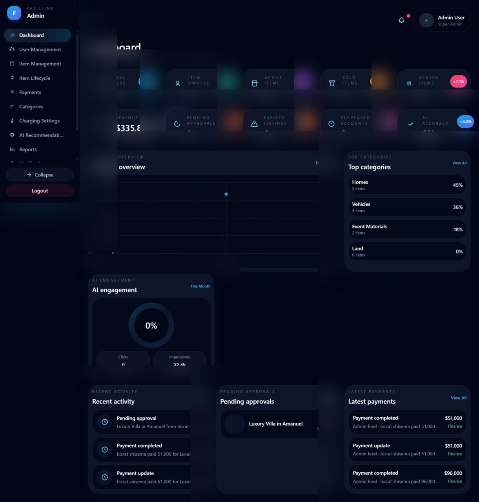

# FasilLink

A full-stack marketplace platform for buying, selling, and renting properties, vehicles, and event items.

**Live demo:** https://fasillink-app.vercel.app
**Code:** this repository

The backend runs on a free server that sleeps when idle, so the first load can take up to a minute.

### Demo accounts

| Role | Email | Password |
|---|---|---|
| Customer | [demo customer email] | [demo password] |
| Owner | [demo owner email] | [demo password] |

Deployed on: Vercel (customer site and admin dashboard), Render (backend API), Neon (PostgreSQL)

FasilLink was developed as a practical marketplace application that brings listings, search, user accounts, communication, administration, and AI-based recommendations into one platform.

## Screenshots

### Marketplace

| Homepage | Register | Login |
|---|---|---|
|  |  |  |

### Listings and Communication

| Listing Details | Real-Time Chat |
|---|---|
|  |  |

### AI and Administration

| AI Recommendations | Admin Dashboard |
|---|---|
|  |  |

## Overview

FasilLink is a marketplace application where users can find and publish listings for properties, vehicles, and event-related items.

Users can create accounts, browse listings, search and filter available items, save favorites, contact other users, and communicate through the platform.

The system also includes an administration dashboard and a separate AI service for recommendation features.

## Main Features

### Marketplace

- Browse available listings
- Property listings
- Vehicle listings
- Event item listings
- Buying and rental listings
- View detailed listing information
- Upload listing images
- Manage personal listings
- Recently added listings
- Similar and recommended listings

### Search and Filtering

- Search marketplace listings
- Browse by category
- Filter listings
- Filter by price
- Sort search results
- View individual listing details

### User Accounts

- User registration
- User login
- Authentication
- User profiles
- Manage personal listings
- Add listings to favorites
- Notifications
- Contact sellers and renters
- Online payments with Chapa (test mode)
- Email verification
- Password reset by email

### Real-Time Chat

FasilLink includes real-time communication between users using Socket.IO.

Users can communicate with other users when they are interested in a listing.

### Admin Dashboard

The project includes a separate administration dashboard for managing the platform.

The administrator can manage areas such as:

- Users
- Listings
- Categories
- Marketplace activity
- Platform information

### AI Recommendations

FasilLink includes a separate Python-based AI service.

The AI service analyzes listing information and user-related data to help provide relevant recommendations.

The recommendation component uses text processing, embeddings, and similarity-based techniques to identify listings that may be relevant to a user.

## System Architecture

```text
                    FasilLink
                        |
        +---------------+-------------------+---------------+
        |               |                   |               |
        v               v                   v               v
    Frontend        Admin Dashboard     Backend API      AI Service
    CRA +           Vite               Node.js         Python/Flask
    TypeScript                          Express
        |               |                   |
        +---------------+-------------------+
                        |
                   PostgreSQL

The React frontend communicates with the Node.js backend through APIs.

The backend manages authentication, listings, users, database operations, communication, and other application functionality.

The AI service runs separately and provides recommendation-related functionality to the backend.

Technology Stack
Frontend
Create React App
React
TypeScript
React Router
Tailwind CSS
Axios
Framer Motion
Lucide React
Socket.IO Client
Admin Dashboard
Vite
React
React Router
Backend
Node.js
Express.js
PostgreSQL
Socket.IO
JWT
bcrypt
Multer
Cloudinary
Chapa (payments)
Brevo transactional email API (Nodemailer SMTP as fallback)
Axios
dotenv
AI Service
Python
Flask
NumPy
Pandas
Scikit-learn
Sentence Transformers
Machine learning
Similarity-based recommendation
Development Tools
Git
GitHub
npm
PostgreSQL
Python
VS Code
Project Structure
FasilLink/
│
├── final project_fasilink/
│
├── frontend/
│
├── backend/
│
├── ai-service/
│
├── admin-dashboard/
│
└── docs/

The main application is organized into separate frontend, backend, AI, administration, and documentation components.

Application Flow
User
 |
 v
Register / Login
 |
 v
Marketplace
 |
 +-------------------+
 |                   |
 v                   v
Search & Filter    Browse Categories
 |                   |
 +---------+---------+
           |
           v
      View Listing
           |
     +-----+-----+
     |           |
     v           v
 Favorite      Contact
                 |
                 v
                Chat
                 |
                 v
        AI Recommendations
Recommendation Flow
User Information
       |
       v
User Preferences
       |
       v
Listing Information
       |
       v
Text Processing
       |
       v
Embeddings
       |
       v
Similarity Analysis
       |
       v
Recommendation Ranking
       |
       v
Recommended Listings

The recommendation system is separated from the main backend so that AI-related functionality can be developed and improved independently.

Authentication

The backend provides authentication for user accounts.

Security-related technologies used in the project include:

JWT authentication
Password hashing with bcrypt
Protected routes
CORS configuration
CORS restricted to the deployed frontend and admin URLs
Environment variables
Request validation and handling

Sensitive values such as passwords, API keys, database credentials, and service keys should be stored in environment variables and should not be committed to GitHub.

Database

FasilLink uses PostgreSQL as the main database.

The database is used to store application information such as:

Users
Listings
Categories
Favorites
Messages
Notifications
Marketplace data
Recommendation-related information

Database schema and related documentation are available in the project documentation.

Create the tables with `backend/schema.sql`.

Getting Started
Prerequisites

Before running the project, install:

Node.js
npm
Python 3
PostgreSQL
Git
1. Clone the Repository
git clone https://github.com/hilinaasres/FasilLink.git
cd FasilLink
2. Install Frontend Dependencies

Navigate to the frontend directory:

cd frontend
npm install

Start the frontend development server:

npm start

The frontend normally runs on:

http://localhost:3000
3. Install Backend Dependencies

Open another terminal and navigate to the backend:

cd backend
npm install

Start the backend:

npm start

The backend uses port 5000 by default.

http://localhost:5000
4. Set Up the AI Service

Open another terminal:

cd ai-service

Create a Python virtual environment:

Windows
python -m venv .venv
.venv\Scripts\activate
Linux / macOS
python3 -m venv .venv
source .venv/bin/activate

Install the Python dependencies:

pip install -r requirements.txt

Start the AI service using the application's Python entry point.

The AI service normally runs separately from the Node.js backend.

Environment Variables

FasilLink uses environment variables for configuration and sensitive information.

Create the required .env files locally.

Example backend configuration:

PORT=5000
AI_SERVICE_URL=http://localhost:5001
DATABASE_URL=<your-database-url>
JWT_SECRET=<your-jwt-secret>
FRONTEND_URL=<your-frontend-url>
ADMIN_URL=<your-admin-url>
BACKEND_URL=<your-backend-url>
BREVO_API_KEY=<your-brevo-api-key>
BREVO_SENDER_EMAIL=<your-brevo-sender-email>
BREVO_SENDER_NAME=<your-brevo-sender-name>
CLOUDINARY_CLOUD_NAME=<your-cloudinary-cloud-name>
CLOUDINARY_API_KEY=<your-cloudinary-api-key>
CLOUDINARY_API_SECRET=<your-cloudinary-api-secret>
CHAPA_SECRET_KEY=<your-chapa-secret-key>

Example frontend configuration:

REACT_APP_API_BASE_URL=<your-api-base-url>

Example admin dashboard configuration:

VITE_API_BASE_URL=<your-api-base-url>

Other environment variables may be required depending on the services enabled in the application, including:

PostgreSQL database configuration
JWT secret
Cloudinary configuration
Email configuration
Payment configuration
AI service configuration

Do not commit real credentials or secret keys to the repository.

Development Architecture

During development, the application can run as separate services:

React Frontend
localhost:3000
       |
       v
Node.js / Express Backend
localhost:5000
       |
       +-------------------+
       |                   |
       v                   v
   PostgreSQL          AI Service
                       localhost:5001

This separation allows each part of the system to be developed and maintained independently.

Real-Time Communication

Socket.IO is used for real-time communication.

The chat functionality allows users to communicate without relying only on traditional HTTP request and response cycles.

This is useful for marketplace interactions where a buyer or renter needs to contact a seller.

File and Image Management

The application supports listing images and file uploads.

The backend uses Multer for handling uploads, while Cloudinary can be used for cloud-based image storage and management.

Admin System

The admin dashboard is separated from the main user interface.

It provides an interface for administrators to monitor and manage important parts of the marketplace.

                    FasilLink
                        |
             +----------+----------+
             |                     |
             v                     v
        User Platform         Admin Dashboard
             |                     |
             v                     v
        Marketplace          Platform Management
Project Documentation

Additional documentation is available in the repository.

The documentation includes information related to:

Database schema
API configuration
Application setup
Deployment
Backend configuration
Frontend configuration
Production Deployment

```text
                              Browser
                             /       \
                            v         v
     Vercel (customer site + admin dashboard)   Render (Express API + Socket.IO)
                                                        |
                              +-------------------------+------------------+
                              |                         |                  |
                              v                         v                  v
                       Neon (PostgreSQL)       Cloudinary (images)   Brevo (email)
```

The AI recommendation service runs locally and is not part of the live demo yet.

What I Learned

This project gave me practical experience with:

Full-stack web development
React and TypeScript
Node.js and Express
PostgreSQL database design
REST API development
Authentication and authorization
Real-time communication with Socket.IO
File and image uploads
Cloud-based image storage
Machine learning
Recommendation systems
Building separate backend services
Git and GitHub
Application deployment
Deploying a full-stack app to Vercel, Render, and Neon
Debugging production issues (CORS, API response caching, blocked SMTP ports)
Replacing SMTP with a transactional email API
Optimistic UI updates and acknowledgments in real-time chat
Future Improvements

Possible improvements for future versions include:

More advanced recommendation models
Improved recommendation personalization
Mobile application
More payment integrations
Better analytics
Automated testing
CI/CD
Deploy the AI recommendation service
Improved notification features
Author

Hilina Asres

Computer Science Student
University of Gondar, Ethiopia

GitHub: @hilinaasres

License

This project was developed as an academic and portfolio project.
